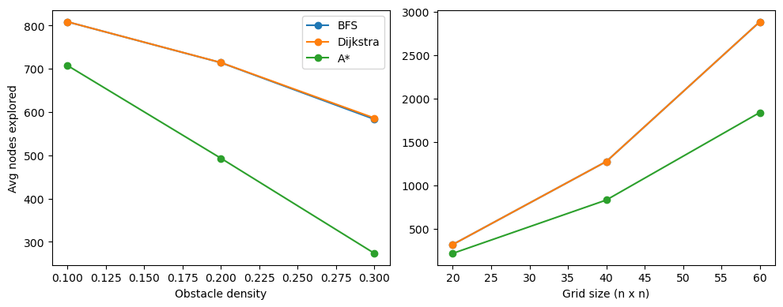

# Grid Path Planning: BFS, Dijkstra, A*, Q-Learning and a Learned Heuristic

A simulation study of path planning on 2D grid maps. I first worked on this during my 7th semester industrial practical training. This repository is a rebuilt and extended version (November 2026).

---

## What is in the notebook
* **Classical Search:** BFS, Dijkstra and A* compared on random 20x20 grid maps
* **Dynamic Obstacles:** Robot re-plans its route when a new obstacle blocks the path
* **Image-to-Grid Map:** An OpenCV step that turns an obstacle image into a grid map
* **Scalability Experiments:** Testing obstacle density, grid size, heuristics and 8-direction movement
* **Reinforcement Learning:** A Q-Learning agent compared with A*
* **Machine Learning Heuristic:** A Random Forest learned heuristic compared with Manhattan distance

---

## Main results
All numbers come from the notebook. Maps are random and seeded, so the node counts repeat when you run it again.

### 1. BFS vs Dijkstra vs A* (20 random 20x20 maps)

| Algorithm | Avg path length | Avg nodes explored |
| :--- | :---: | :---: |
| **BFS** | 38.6 | 316.5 |
| **Dijkstra** | 38.6 | 316.6 |
| **A*** | 38.6 | 214.6 |


### 2. Obstacle density & Grid size scaling
*(30x30 maps, nodes explored, BFS vs A*)*

| Density | BFS | A* |
| :---: | :---: | :---: |
| **0.1** | 808.2 | 707.4 |
| **0.2** | 713.8 | 493.0 |
| **0.3** | 583.1 | 273.2 |



### 3. Dynamic Replanning & OpenCV Image Maps
* **Dynamic Navigation:** When unexpected obstacles appear mid-route, the agent dynamically recalculates a valid path to the goal.
* **OpenCV Map Conversion:** Custom obstacle images are processed into binary grids for pathfinding.

| Dynamic Replanning | A* on OpenCV Image Map |
| :---: | :---: |
|  |  |

### 4. Q-Learning vs A*
On 10 random maps, the Q-Learning agent (3000 training episodes per map) reached the goal every time, with the same path length as A*. A* needs no training.

| Training Curve (Reward) | Learned Path |
| :---: | :---: |
|  |  |

### 5. Learned Heuristic (Random Forest)
The Random Forest predicted distance-to-goal with a mean error of `1.04`, against `1.26` for Manhattan distance. When I compared it with Manhattan distance that uses a tie-breaking rule, the Manhattan version explored fewer nodes (`66.9` against `110.2`) and ran much faster. The learned heuristic took roughly **100 times longer** because of feature computation and model prediction. So in this setup, a simple tie-breaking rule beat the learned heuristic.

---

## Limitations
* 2D simulation only, with small grids
* One model type (Random Forest), trained on one obstacle density
* No real robot and no sensor noise
* Timings change from run to run, node counts do not

---

## How to run
1. Install the packages:
   ```bash
   pip install -r requirements.txt
   ```
2. Open `navigation.ipynb`
3. Run all cells from top to bottom

*Tested with Python (Anaconda), `scikit-learn 1.0.2` and `numpy 1.21.5`.*
